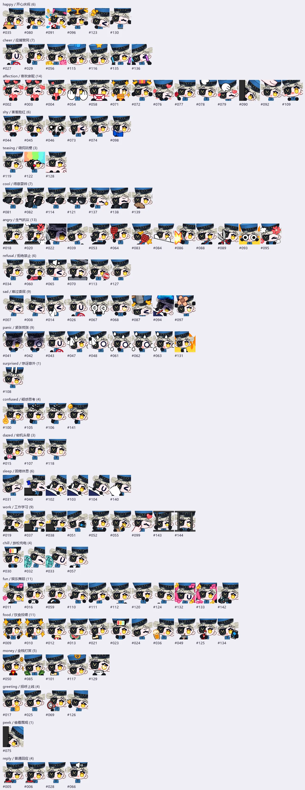

# 卡罗莉娜半身表情包 · Caroline Stickers

《女神异闻录 5 / Persona 5》卡罗莉娜（Caroline／カロリーヌ）非官方同人聊天表情包，使用 **EmoteLab CoffeeBean 模板与动画**制作，按 **AstrBot Meme Manager** 聊天语义分类。

银灰双丸子、鲜艳蓝金狱卒制服、`X-M-R-N` 帽子，以及角色左眼（画面右侧）的金 V 黑眼罩。采用半身构图，未额外添加瞳孔。

## 下载与导入

**[下载 v1.0.0 完整资源包](downloads/caroline-stickers-1.0.0.zip?raw=true)**（约 2.45 MiB）

1. 下载 ZIP，无需手动解压。
2. 打开 AstrBot Meme Manager WebUI 的“导入与备份”。
3. 选择 ZIP，检查摘要应为 **5 个分类、5 张动态图**，再确认导入。
4. 先实际发送一张，确认平台的 GIF 播放、透明背景和文件大小限制，再启用自动选图。

旧版插件若不支持此格式，可解压后按分类导入 `memes/` 内的 GIF；不要重复导入 `masters/` 内母版。

## 动态预览

| 开心 / happy | 生气 / angry | 疑惑 / confused |
| :---: | :---: | :---: |
|  |  |  |

| 害羞 / shy | 睡觉 / sleep |
| :---: | :---: |
|  |  |

## 内容与规格

| 分类 | 用途 | 帧数 | 时长 |
| --- | --- | ---: | ---: |
| `happy` | 开心、大笑、得意、庆祝 | 20 | 1.0 秒 |
| `angry` | 生气、抗议、责备、吐槽 | 40 | 2.0 秒 |
| `confused` | 疑惑、问号、没听懂 | 24 | 1.2 秒 |
| `shy` | 害羞、脸红、被夸奖 | 20 | 1.0 秒 |
| `sleep` | 困倦、盖被子、晚安、离开 | 54 | 2.7 秒 |

- 5 张 **240×240 透明 GIF**，20 FPS，无限循环，每张小于 500 KiB。
- 5 张 **800×800 透明 PNG 母版**，可用于静态表情。
- `manifest.json`、`memes_data.json`、`meme_pack_export.json` 提供分类和 v2 导入元数据。
- `previews/` 包含封面、整组预览、动作抽查图。
- `validation.json`、`checksums.json` 记录原始资源包检查与校验和；`import-check.json` 记录上游压缩包检查。
- 更详细的导出与使用说明见 [USAGE.md](USAGE.md)。

这是 **五类基础包**，并非全动作合集。睡觉采用盖被子模板，其余为上身与手部半身构图。

## 验证范围

- GIF 全部帧可解码、存在实际动作，并检查帧数、时长与循环设置。
- 逐帧核对二值透明掩码；角色与道具未触碰画布边界。
- ZIP 完整性与校验和已检查。
- 使用 Meme Manager 上游 `inspect_pack_archive` 及其本地辅助函数离线检查：识别为 v2、5 类、5 张、无警告。

**尚未连接实际 AstrBot 实例，未实测 WebUI 导入和聊天发送。** 离线检查不等于目标平台实测。EmoteLab 软件内载入定制角色也未验证；本仓库交付可独立发送的图片，不提供可安装角色工程。

GIF 不支持半透明，本包以 alpha 128 为阈值编码，透明边缘与 PNG 母版不完全一致。

## 来源与权利

- 角色：ATLUS《Persona 5》Caroline／カロリーヌ。[官方角色参考](https://persona5.jp/character/velvet.html)
- 模板、骨架及动画：[EmoteLab](https://emotelab.app/)，CoffeeBean v1.9；素材画师：**0x4682B4（失效药片）**。
- 离线工具：[mofei-114/emotelab-skill](https://github.com/mofei-114/emotelab-skill)，第三方工具，非 EmoteLab 官方工具。
- 风格及分类参考：[anka-afk/seio-stickers@v2026.09.0](https://github.com/anka-afk/seio-stickers/tree/v2026.09.0)，未复制其成品 GIF。
- 导入协议：[AstrBot Meme Manager](https://github.com/anka-afk/astrbot_plugin_meme_manager)。

这是非官方同人作品，与 ATLUS、EmoteLab 和 AstrBot 官方无隶属关系。角色、基础模型及动画权利归各自权利人；不以开源代码许可证对这些图片作额外授权。未取得原作角色商业授权，建议限个人非商业聊天使用，不用于销售或商品化。使用前请阅读 [EmoteLab 资产使用说明](https://emotelab.app/assets/usage-guide/) 和 [完整来源说明](SOURCES.md)。

仓库与下载包均不包含 EmoteLab 原始图集、骨架、软件文件或其他作者的参考图片。
